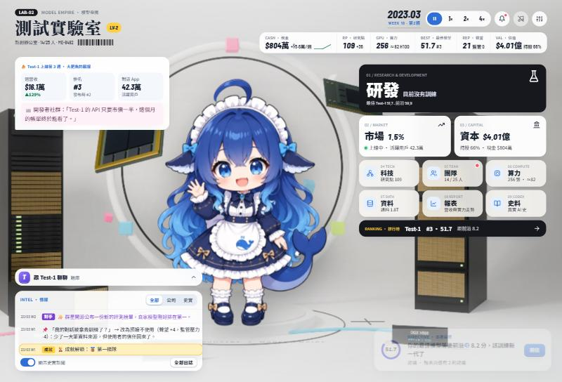
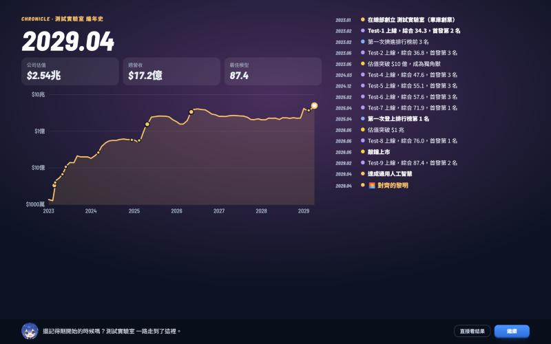

# 模型帝國 Model Empire

大模型創業經營策略遊戲（網頁版，繁體中文）。2023 年 1 月，你帶著種子輪和 64 張舊卡創立一家 AI 公司：設計模型配方、搶算力、挖人才、和六家對手搶排行榜與市佔。接近終點時進入最後一幕，比的是誰先安全抵達 AGI，而對手也可能搶先。



## 怎麼玩

**線上：** https://otis222.github.io/model-empire/

**本機：** 需要 [Node.js](https://nodejs.org/)，不用安裝其他套件。

```bash
node tools/build.js
```

然後用瀏覽器打開 `dist/model-empire.html`。存檔留在你的瀏覽器裡。

## 遊戲內容

- **真實 AI 史當背景：** 論文、晶片、法規和新聞都照真實日期出現，每項科技都附論文出處。2026 年 11 月之後的事件是推演出來的虛構未來。
- **118 項科技、8 條路線：** 研究要花時間，同時能做的項目有限，有 14 組多選一，一局研究不完。
- **AGI 競賽：** 最後一幕有專屬事件，你和對手各有進度。2030 年底起每年底可以選擇收手結算，最晚打到 2035 年底。
- **14 種結局：** 從對齊的黎明、眾人的火種，到別人的黎明、資金鏈斷裂。結局會回顧這一局的編年史和最終排名。
- **和自己的模型聊天：** 按題目免費，回答好壞看模型的能力分數。也可以接任何 OpenAI 相容的服務自由打字，金鑰只存在你的瀏覽器，不會進存檔。




## 專案結構

| 路徑 | 內容 |
|---|---|
| `src/data.js` | 靜態資料表：總部城市、GPU、機房、科技樹、市場、對手、平衡常數、成就、結局 |
| `src/content.js` | 文案內容：互動事件、新聞時間軸、模型試聊題庫、明星人才 |
| `src/engine.js` | 遊戲引擎（純邏輯、無 DOM，可在 Node 執行） |
| `src/ui.js`、`src/style.css` | 介面層和樣式 |
| `src/icons.js` | 科技、路線的線條圖示，GPU、機房的物件圖示（SVG） |
| `src/history.js` | 真實 AI 史料，由 `research/` 產生 |
| `src/assets/` | 美術資產（WebP）；授權見 [CREDITS.md](CREDITS.md) |
| `research/` | 真實背景資料（JSON，含來源與可信度） |
| `tools/build.js` | 把 `src/` 內嵌成單一 HTML，輸出到 `dist/` |
| `tools/sim.js` | 無頭平衡模擬：`node tools/sim.js <seed> <balanced\|cheap\|open\|frontier> <garage\|spinoff\|embargo>` |
| `tools/pacing.js` | 節奏與難度統計：`node tools/pacing.js 12 --detail` |
| `tools/validate_content.js` | 內容檔驗證（id、效果鍵、條件鍵） |
| `tools/uitest.js` | Playwright 介面煙霧測試（要另外安裝 Playwright） |
| `tools/merge_research.js` | `research/*.json` → `src/history.js` 與 `docs/bible.html` |
| `tools/cutout.py`、`tools/avatars.py`、`tools/bg_post.py`、`tools/blender/` | 美術流程腳本（需要 `art/` 的原始檔，原始檔不在這個 repo 裡） |
| `docs/bible.template.html` | 設定集模板 |

## 開發

```bash
node tools/validate_content.js   # 驗證內容
node tools/sim.js 1 balanced     # 跑一局機器人模擬
node tools/pacing.js 12          # 統計破產率、結局分布和評等
```

核心公式：

- 有效算力 = 6 × 等效參數 × 有效資料 × Chinchilla 效率 × 資料品質 × 演算法加成 × 人才
- 基礎分 S0 = 8.5 × log10(有效算力 / 10^19) + 8.5
- 市佔 = softmax（能力適配、落後前沿懲罰、聲望、價格、通路、賣點）

目前的平衡是用機器人模擬校準的，還沒有大量真人試玩，歡迎回報手感。

## 授權與致謝

- **程式碼：** [MIT](LICENSE)。
- **美術：** 吉祥物圖片（`src/assets/char_*.webp`、`avatar_*.webp`）**不適用 MIT**。它們來自粉絲二次創作，僅限非商用，授權和出處見 [CREDITS.md](CREDITS.md)。
- **靈感來源：** B 站 Toy《鯨魚娘養成計劃》（作者 Anria_）與《手機帝國》。

吉祥物都是粉絲二次創作的虛構擬人角色，與各 AI 產品官方、運營主體及相關公司沒有任何關聯，也不代表對任何產品的評價。遊戲裡的對手公司都是虛構的。
